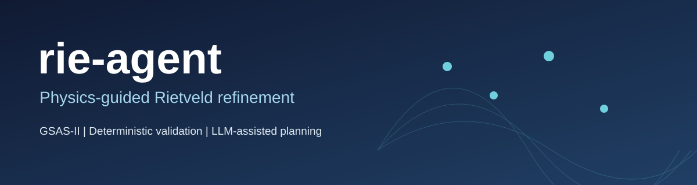
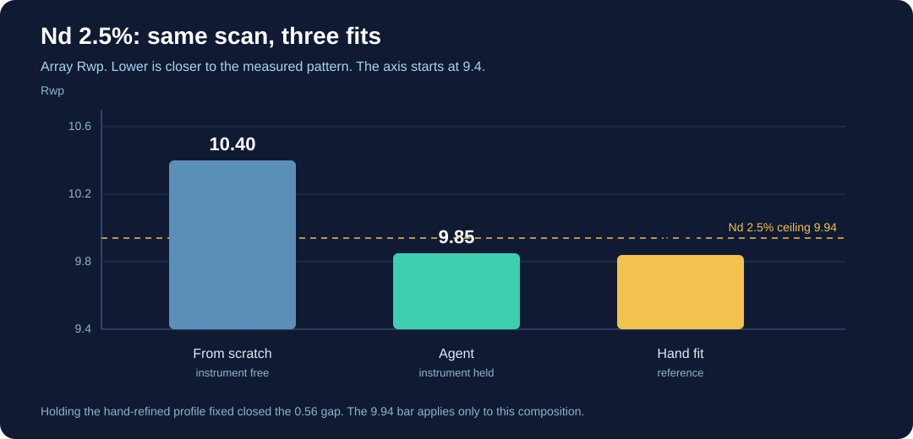

<div align="center">



<br />

[](docs/SETUP.md)
[](https://github.com/AdvancedPhotonSource/GSAS-II)
[](LICENSE)
[](docs/ROADMAP.md)
[](docs/ROADMAP.md)

**A research-oriented agent for staged, physically validated Rietveld refinement.**

[Architecture](#architecture) · [Getting started](#getting-started) · [Development roadmap](docs/ROADMAP.md) · [Setup notes](docs/SETUP.md)

</div>

---

## Overview

**rie-agent** combines [GSAS-II](https://github.com/AdvancedPhotonSource/GSAS-II) numerical refinement with a constrained planning layer. The refinement engine computes the parameters; deterministic checks evaluate whether a stage is acceptable. An optional local LLM proposes remediation actions but does **not** decide numerical validity.

The primary research context is Nd-substituted BiFeO₃ powder diffraction. The codebase is being developed and benchmarked; it is **not** a validated turnkey refinement service.

## Architecture

```text
Powder diffraction + CIF + instrument parameters
                     |
                     v
             GSAS-II refinement
                     |
                     v
         Deterministic validation
             /               \
          Accept             Reject
            |                   |
        Next stage       Restore checkpoint
                                |
                         Planner suggests
                         remediation action
                                |
                         Retry and validate
```

| Component | Responsibility | Source |
| --- | --- | --- |
| Lab recipe | Stage order and locks for the BiFeO₃ lab scan: Bi1 origin, profile terms, uniaxial size | [`src/recipe.py`](src/recipe.py) |
| Staged refinement | Scale/background, cell, profile, atomic positions and thermal parameters | [`src/refine_staged.py`](src/refine_staged.py) |
| Agent orchestration | Stage progression, checkpoint/rollback and remediation; local Ollama or rule-based fallback | [`src/agent.py`](src/agent.py) |
| Physical validation | Explicit checks on refinement quality and physical parameter constraints | [`src/validators.py`](src/validators.py) |
| Secondary-phase investigation | Residual-peak screening and isolated candidate-phase scale trials | [`src/phase_hunter.py`](src/phase_hunter.py) |

### Design principles

- **Physics before model judgment:** acceptance and rejection rely on explicit checks, not LLM-generated scores.
- **Traceable stages:** refinement progress and decisions are recorded for inspection.
- **Reversible experiments:** rejected trials can return to a prior accepted state.
- **Constrained AI:** optional Ollama planning selects from supported actions; rules provide a fallback.
- **Conservative phase screening:** candidate phases are trialed on copies of the project, with deterministic acceptance criteria.

## Getting started

Development environment documented for **Windows 11 + WSL2 / Ubuntu 24.04**, Conda, Python 3.12 and GSAS-II installed from source. Follow the [full setup guide](docs/SETUP.md) for binary and dependency details.

```bash
conda activate rie-agent
export GSASII_PATH="$HOME/GSAS-II"
python src/agent.py DATA.xye PHASE.cif INSTRUMENT.instprm --outdir results --label trial
```

For a rule-only run without Ollama, append `--no-llm`. Replace the example filenames with your own compatible diffraction, CIF and instrument files. This command is a development entry point, not a guarantee of convergence.

The Nd2.5 regression uses a provisional instrument transferred from the hand refinement in `results/agent_llm.gpx`. It is a transfer of that fit, not a Si or LaB₆ calibration. A filename containing `provisorio`, or the flag `--fixed-instrument`, holds U, V, W, X, Y, Zero and SH/L fixed while the sample parameters still refine.

```bash
python src/agent.py data/samples/Nd2p5_850.xye data/samples/BFO.cif \
  data/instrument/shimadzu_nd_provisorio.instprm \
  --outdir results --label nd2p5_regress --no-llm
```

That run finishes at array Rwp 9.85, GOF 1.78 and VERDICT OK. It passes validation, so the planner is not called.

On a sample that fails validation, `src/agent.py` asks local Ollama (`qwen2.5:7b`) for one action from a fixed menu. Before choosing, the planner reads `results/run_memory.json`: Nd fraction, Rwp, verdict, and which actions were kept or rejected on earlier samples. The menu includes `nominal_nd` when the Nd fraction is given with `--nd` or is readable from the filename (`Nd10`, `Nd2p5`), and one `phase_` action per CIF in `data/phases/`. The model does not edit parameters. Validators roll back an action that does not improve the array Rwp; a secondary phase is kept only when Rwp drops by at least 0.20. `--no-llm` uses the same menu through the rule fallback. The 9.94 ceiling is applied only to the Nd 2.5% regression.

The same frozen instrument on Nd 5% (`data/samples/Nd5_870.xye`, pure BiFeO₃) finishes at Rwp 10.13, GOF 1.78 and VERDICT OK. On Nd 10% the pure BiFeO₃ control reaches Rwp 11.07 with negative Fe and O Uiso. With Ollama choosing the actions, the agent sets Bi 0.90 / Nd 0.10 (`Nd+3`) and, if oxygen Uiso is still negative, holds it. That run finishes at Rwp 10.91, GOF 2.07 and VERDICT OK (`results/nd10_auto.gpx`).

For secondary-phase screening, see [`src/phase_hunter.py`](src/phase_hunter.py) and its usage documentation.

## Where the fits stand

Both figures use array Rwp from the runs in [`results/`](results/). The stored covariance Rwp is not plotted.



On the Nd 2.5% scan the from-scratch agent stops at 10.40, above the 9.94 ceiling. Freezing the profile taken from the hand fit brings the same recipe to 9.85, beside the hand result at 9.84.


With that instrument held fixed, the R3c model stays near Rwp 10 through 10% Nd (9.85, 10.13, 10.91), all VERDICT OK. At 15% it is 12.61 and still beats the Pnma trial at 16.97 and the Pbam trial at 16.95. At 20% the same R3c model reaches 21.64.

## Research scope and maturity

Current development centers on **Bi₁₋ₓNdₓFeO₃** and laboratory powder X-ray diffraction. Neutron powder diffraction is part of the broader intended scope. The [roadmap](docs/ROADMAP.md) marks staged refinement, validators, agent orchestration and secondary-phase screening as completed development sprints, with **benchmarking currently in progress**. Visualization, publication and release milestones remain planned.

## Repository guide

- [`src/`](src/) — refinement, orchestration, validation and phase screening
- [`data/`](data/) — research inputs and sample assets
- [`docs/SETUP.md`](docs/SETUP.md) — environment and installation notes
- [`docs/DECISIONS.md`](docs/DECISIONS.md) — architectural decisions
- [`docs/ROADMAP.md`](docs/ROADMAP.md) — completed and planned work

## License and attribution

The repository is released under the [MIT License](LICENSE). **GSAS-II is a separate dependency** with its own terms. This project is an independent research tool built around its scripting interface.

<div align="center"><sub>Scientific computing · Powder diffraction · Reproducible refinement</sub></div>
